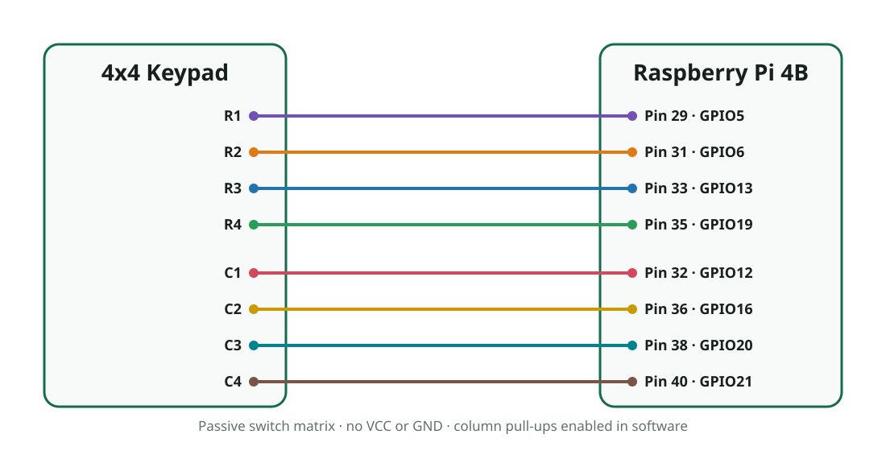

# 4x4 matrix keypad with HD44780 display

The project image runs `keypad-display.service`. It scans a passive eight-wire
4x4 matrix keypad and shows the most recently pressed key on the project's
parallel HD44780 LCD. The supported layout is:

```text
1  2  3  A
4  5  6  B
7  8  9  C
*  0  #  D
```



## Wiring

Power off the Raspberry Pi before changing the wiring. The table assumes the
keypad connector is ordered `R1 R2 R3 R4 C1 C2 C3 C4`. Check the labels or
continuity of the specific keypad before connecting it because some modules use
a different pin order.

| Keypad signal | Raspberry Pi GPIO | Physical pin |
| --- | --- | --- |
| R1 | GPIO5 | 29 |
| R2 | GPIO6 | 31 |
| R3 | GPIO13 | 33 |
| R4 | GPIO19 | 35 |
| C1 | GPIO12 | 32 |
| C2 | GPIO16 | 36 |
| C3 | GPIO20 | 38 |
| C4 | GPIO21 | 40 |

Use the LCD wiring in [HD44780 character LCD](hd44780.md). A passive matrix
keypad needs no VCC or ground connection: its eight pins are four row contacts
and four column contacts. Do not connect any keypad line to 5 V. The service
enables the Raspberry Pi's internal pull-ups on the four column inputs.

These assignments avoid the LCD GPIOs, the SPI0 pins used by the MFRC522, and
the UART and I2C pins enabled by the board configuration. GPIO25 remains shared
by the LCD and MFRC522 reset, so `keypad-display` and `mfrc522-tool` still cannot
run at the same time with the current LCD wiring.

## Image integration

The `keypad-display` recipe cross-compiles the libgpiod application, installs
it as `/usr/bin/keypad-display`, and enables `keypad-display.service`. The
service starts automatically at boot and restarts after a runtime failure.

Build the image and signed OTA bundle with:

```sh
./scripts/build-rpi4b.sh rpi4-update-bundle
```

## Verify operation

After booting the image, check the service:

```sh
systemctl status keypad-display --no-pager -l
journalctl -u keypad-display -b --no-pager
```

The LCD initially shows `KEYPAD READY`. Pressing a key changes it to `KEY: X`,
where `X` is the key label. A held key is registered once and must be released
before it can be registered again. The service applies a 30 ms debounce interval.

The service owns the six LCD lines and all eight keypad lines. Confirm ownership
with:

```sh
gpioinfo -c gpiochip0 | grep -E 'line +(5|6|12|13|16|17|18|19|20|21|22|23|24|25):'
```

To run the standalone LCD test, stop this service first:

```sh
systemctl stop keypad-display
/tmp/test-hd44780-rpi4b.sh
systemctl start keypad-display
```

If the displayed characters do not match the pressed keys, the keypad's eight
connector pins are not in the assumed row/column order. Identify each row and
column with the keypad's datasheet or a continuity meter, then connect those
signals according to the table above.
